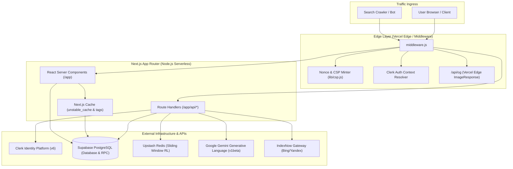
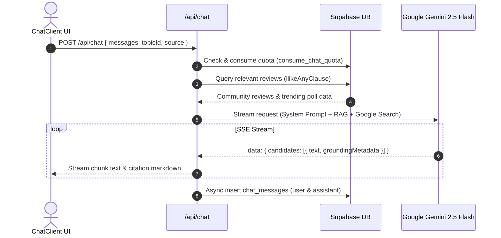

# KastoChha (कस्तो छ?) — The Definitive Technical & Architecture Manual

> **"Kasto chha?"** *(Nepali: "How is it?")* — Nepal's community-driven opinion network, real-world review platform, and AI answer engine. Built for Nepalis, by Nepalis.

---

## Document Overview
This document represents the definitive, exhaustive architectural specification and technical manual for the **KastoChha** platform. It covers every subsystem, database migration, stored procedure, custom hook, API route, security boundary, ranking algorithm, and operational runbook.

---

## Table of Contents
1. [Product Vision, Core Tenets & Voice](#1-product-vision-core-tenets--voice)
2. [High-Level Architecture & Request Lifecycles](#2-high-level-architecture--request-lifecycles)
3. [Technology Stack & Runtime Matrix](#3-technology-stack--runtime-matrix)
4. [Domain Model & Relational Database Architecture](#4-domain-model--relational-database-architecture)
   - 4.1 [Relational Schema & Tables](#41-relational-schema--tables)
   - 4.2 [Database Views & Composite Aggregations](#42-database-views--composite-aggregations)
   - 4.3 [Indexes & Query Optimization](#43-indexes--query-optimization)
   - 4.4 [Stored Procedures & Concurrency Control (PL/pgSQL)](#44-stored-procedures--concurrency-control-plpgsql)
   - 4.5 [Database Migration Ledger (0001–0016)](#45-database-migration-ledger-00010016)
   - 4.6 [Row Level Security (RLS) Matrix](#46-row-level-security-rls-matrix)
5. [Core Subsystems & Deep Engineering Analysis](#5-core-subsystems--deep-engineering-analysis)
   - 5.1 [KastoChha Assist (AI Conversational Engine)](#51-kastochha-assist-ai-conversational-engine)
   - 5.2 [Trending Searches Ranking Engine](#52-trending-searches-ranking-engine)
   - 5.3 [Discussions & The Question-Experience Convergence](#53-discussions--the-question-experience-convergence)
   - 5.4 [Atomic Voting Engine](#54-atomic-voting-engine)
   - 5.5 [Head-to-Head Battles & Trending Polls](#55-head-to-head-battles--trending-polls)
   - 5.6 [Editorial Publishing & Featured Stories](#56-editorial-publishing--featured-stories)
   - 5.7 [Niche Video Reels Rail & Media Proxy](#57-niche-video-reels-rail--media-proxy)
   - 5.8 [Admin Control Plane & Write-Ahead Audit Log](#58-admin-control-plane--write-ahead-audit-log)
   - 5.9 [Authentication, RBAC & The Terms Consent Gate](#59-authentication-rbac--the-terms-consent-gate)
6. [Frontend Architecture & Custom Hooks Reference](#6-frontend-architecture--custom-hooks-reference)
   - 6.1 [Client Hydration & Layout Architecture](#61-client-hydration--layout-architecture)
   - 6.2 [Interactive Hooks & Client State Machines](#62-interactive-hooks--client-state-machines)
   - 6.3 [Typography & Global Design System](#63-typography--global-design-system)
7. [Exhaustive API Specification](#7-exhaustive-api-specification)
8. [Security Architecture & Resilience](#8-security-architecture--resilience)
   - 8.1 [Content Security Policy (CSP) with Strict-Dynamic Nonces](#81-content-security-policy-csp-with-strict-dynamic-nonces)
   - 8.2 [Two-Tier Hybrid Rate Limiting Architecture](#82-two-tier-hybrid-rate-limiting-architecture)
   - 8.3 [Client IP Resolution & Anti-Spoofing Proxy Depth](#83-client-ip-resolution--anti-spoofing-proxy-depth)
   - 8.4 [Streaming Request Body Byte-Limit Guard](#84-streaming-request-body-byte-limit-guard)
   - 8.5 [Cryptographic HMAC Anonymization & Privacy](#85-cryptographic-hmac-anonymization--privacy)
9. [SEO, Structured Data & Syndication](#9-seo-structured-data--syndication)
   - 9.1 [The Indexation Gate (Thin Content Protection)](#91-the-indexation-gate-thin-content-protection)
   - 9.2 [Dynamic XML Sitemap with Honest `lastmod`](#92-dynamic-xml-sitemap-with-honest-lastmod)
   - 9.3 [IndexNow Instant Push Notification Protocol](#93-indexnow-instant-push-notification-protocol)
   - 9.4 [Semantic JSON-LD Structured Data](#94-semantic-json-ld-structured-data)
   - 9.5 [Dynamic Edge Open Graph Image Generation](#95-dynamic-edge-open-graph-image-generation)
10. [Configuration & Environment Reference](#10-configuration--environment-reference)
11. [Developer Operations, Runbooks & Testing Strategy](#11-developer-operations-runbooks--testing-strategy)

---

## 1. Product Vision, Core Tenets & Voice

### 1.1 The Problem Space
In Nepal, consumers face significant information asymmetry. Major financial decisions (such as buying IPOs, mutual funds, or secondary market stocks), consumer tech purchases (smartphones, EV motorbikes, laptops), travel itineraries (Annapurna Base Camp, Langtang, Rara), and lifestyle choices (renting apartments in Kathmandu, taking job offers abroad) rely on fragmented word-of-mouth or sponsored social media hype.

### 1.2 Core Tenets
1. **Real Talk Over Hype**: Feedback must reflect lived experiences. Paid promotions and bot reviews are actively suppressed.
2. **Authentic Linguistic Identity**: Rather than formal English or stiff Devanagari script, the conversational AI communicates in **Romanized Nepali** mixed naturally with English vocabulary, matching the exact way modern Nepalis text and converse.
3. **Atomic Data Integrity**: Community sentiment cannot be gamed. Votes, quotas, and ledger states are synchronized within transaction boundaries under explicit row locks.
4. **Radical Privacy**: Unauthenticated visitors are protected. Guest IPs are never stored in plain text; instead, they are transformed into keyed, salted cryptographic HMAC digests.
5. **Quality-Gated Search Indexing**: The site refuses to index shallow or empty pages, preserving domain credibility and crawl budget.

---

## 2. High-Level Architecture & Request Lifecycles

KastoChha operates on a serverless and edge-native model leveraging Next.js 14 App Router on Vercel, paired with managed PostgreSQL on Supabase and fast in-memory rate limiting via Upstash Redis.



### Complete Request Lifecycle
1. **Edge Middleware (`middleware.js`)**:
   - Intercepts non-API traffic.
   - Generates a fresh 16-byte cryptographically secure random nonce (`createNonce()`).
   - Builds a strict Content Security Policy (`buildContentSecurityPolicy()`).
   - Injects `x-nonce` and `content-security-policy` into both request headers (for Next.js RSC and Clerk) and response headers.
2. **Server Execution (RSC)**:
   - Server components fetch relational data through `lib/supabase/server.js` using the privileged `SUPABASE_SERVICE_ROLE_KEY`.
   - Checks user identity via `auth()` from `@clerk/nextjs/server`.
   - Embeds pre-rendered HTML, server-fetched votes (`getUserVotes`), and structured JSON-LD schemas.
3. **Client Hydration & Interaction**:
   - Hydrates React components (`HomeClient`, `ChatClient`, `ExperienceClient`).
   - Evaluates `<TermsGate />`: If the signed-in user hasn't consented to `TERMS_VERSION`, a modal locks interactions until accepted.

---

## 3. Technology Stack & Runtime Matrix

| Layer | Component | Version | Runtime | Architectural Responsibility |
| :--- | :--- | :--- | :--- | :--- |
| **Framework** | Next.js | `14.2.25` | Node.js 18+ / Edge | App Router, Server Components, Streaming, API Handlers |
| **UI Library** | React | `18.2.0` | Client / Browser | Virtual DOM, Hooks, Concurrent Transitions |
| **CSS System** | Tailwind CSS | `4.3.0` | Build / PostCSS | Utility-first CSS, custom design tokens, responsive rules |
| **Identity** | Clerk | `6.39.4` | Node.js & Client | Authentication, Sessions, Custom Metadata RBAC |
| **Database** | PostgreSQL | 15+ (Supabase) | Postgres Engine | Relational persistence, PL/pgSQL routines, RLS, Trigrams |
| **DB Client** | `@supabase/supabase-js` | `2.106.2` | Node.js | Typed SQL queries, RPC invocation, service-role isolation |
| **SSR DB Client**| `@supabase/ssr` | `0.10.3` | Node.js | Cookie-based Supabase authentication context helper |
| **Rate Limiter** | Upstash Redis | `@upstash/ratelimit` `2.0.8` | Node.js / REST | Global sliding-window per-minute burst rate limiting |
| **AI / LLM** | Google Gemini | Generative Language v1beta | HTTP / SSE | `gemini-2.5-flash` model, streaming answers, search grounding |
| **Edge Images** | `@vercel/og` | `next/og` | Vercel Edge | Dynamic SVG/PNG Open Graph card rasterization |
| **Test Runner** | Node Test Runner | Node.js Built-in | Node.js `--test` | Native ES-module integration testing |
| **In-Memory DB**| `@electric-sql/pglite`| `0.5.8` | WASM / Node.js | Embedded real PostgreSQL engine for test isolation |

---

## 4. Domain Model & Relational Database Architecture

The persistence model is strictly relational, normalized for integrity while supporting high-throughput aggregations via targeted PostgreSQL views and indexes.

### 4.1 Relational Schema & Tables

```mermaid
erDiagram
    chat_topics ||--o{ chat_messages : "has many"
    trending_topics ||--o{ user_votes : "voted via"
    battles ||--o{ user_votes : "voted via"
    reviews ||--o{ user_votes : "voted via"
    reviews ||--o{ reviews : "replies in thread"

    trending_topics {
        uuid id PK
        int rank
        text category
        text title
        text slug
        text description
        text badge_label
        text badge_tone
        text trend_note
        text yes_label
        text mid_label
        text no_label
        int votes_yes
        int votes_mid
        int votes_no
        int likes
        int comments
        timestamptz created_at
        timestamptz updated_at
    }

    battles {
        uuid id PK
        int order
        text category
        text slug
        text left_title
        text left_desc
        int left_votes
        text left_color
        text left_image
        text right_title
        text right_desc
        int right_votes
        text right_color
        text right_image
        timestamptz created_at
    }

    reviews {
        uuid id PK
        text kind "experience | question"
        text category
        text topic
        text topic_slug
        text title
        text summary
        text verdict "Ramro chha | Thikai chha | Naramro chha"
        int upvotes
        int downvotes
        text author_name
        int comment_count
        text user_id
        timestamptz created_at
        timestamptz updated_at
    }

    chat_topics {
        uuid id PK
        text user_id
        text title
        int message_count
        timestamptz last_message_at
        timestamptz archived_at
        text opening_query
        text source "trending | chip | question | prompt"
        text guest_key
        timestamptz created_at
        timestamptz updated_at
    }

    chat_messages {
        uuid id PK
        uuid topic_id FK
        text user_id
        text role "user | assistant"
        text content
        timestamptz created_at
    }

    chat_usage {
        uuid id PK
        text identity "user:<id> | ip:<hash>"
        timestamptz created_at
    }

    trending_search_rules {
        uuid id PK
        text term
        text action "hide | fallback"
        int rank
        text note
        timestamptz created_at
    }

    user_votes {
        uuid id PK
        text user_id
        text target_type "trending | battle | review"
        uuid target_id
        text value
        timestamptz created_at
    }

    admin_audit_log {
        uuid id PK
        timestamptz created_at
        timestamptz completed_at
        text actor_id
        text action
        text target_type
        text target_id
        jsonb before
        jsonb after
        text status "pending | applied | failed"
    }

    featured_stories {
        uuid id PK
        text slot "main | side"
        text title
        text slug
        text author_name
        text why_text
        text description
        text body
        text link_url
        text image_url
        text image_alt
        text icon
        timestamptz created_at
        timestamptz updated_at
    }

    reels {
        uuid id PK
        int order
        text tag
        text title
        text handle
        text accent
        text video_url
        text channel_url
        timestamptz created_at
    }

    site_stats {
        uuid id PK
        int order
        text label
        text value
    }

    author_profiles {
        uuid id PK
        text user_id UK
        text display_name
        text bio
        text avatar_url
        text title
        jsonb links
        timestamptz created_at
        timestamptz updated_at
    }
```



### 4.2 Database Views & Composite Aggregations

#### `public.discussion_threads` View
Grouping discussions over HTTP via PostgREST is inefficient and constrained by client row limits. Migration `0008` introduced a dedicated PostgreSQL view:
```sql
create or replace view public.discussion_threads
  with (security_invoker = on)
as
select
  topic_slug,
  min(created_at)                              as started_at,
  max(created_at)                              as last_activity,
  count(*)                                     as post_count,
  count(*) filter (where kind = 'experience')  as experience_count,
  count(*) filter (where kind = 'question')    as question_count
from public.reviews
where topic_slug is not null and btrim(topic_slug) <> ''
group by topic_slug;
```
- **Invoker Semantics (`security_invoker = on`)**: Guarantees the view respects the executing role's RLS constraints instead of bypassing them as a default `SECURITY DEFINER` view would.
- **Paging Support**: Enables `.range(offset, offset + limit - 1)` on thread-level entities directly in PostgreSQL.

### 4.3 Indexes & Query Optimization
- `idx_reviews_topic_slug`: Fast grouping and thread reconstruction by `topic_slug`.
- `idx_reviews_kind`: Filters questions vs experiences.
- `idx_user_votes_user`: Composite `(user_id, target_type)` for pre-rendering a user's voted state.
- `idx_user_votes_target`: `(target_type, target_id)` for counting operations and foreign key joins.
- `idx_chat_topics_user`: Composite `(user_id, last_message_at desc)` for sidebar rendering.
- `idx_chat_topics_title_trgm`: PostgreSQL Trigram index (`gin (title gin_trgm_ops)`) using extension `pg_trgm` for fuzzy topic title search.
- `idx_chat_usage_identity`: Composite `(identity, created_at desc)` powering advisory-locked rate limit lookups.
- `idx_admin_audit_target`: Composite `(target_type, target_id, created_at desc)` for entity revision histories.

### 4.4 Stored Procedures & Concurrency Control (PL/pgSQL)

#### 1. Atomic Vote Resolution: `public.cast_vote`
```sql
create or replace function public.cast_vote(
  p_user_id text,
  p_target_type text,
  p_target_id uuid,
  p_value text
)
returns jsonb
language plpgsql
security invoker
set search_path = public
as $$
declare
  v_prev text;
  v_next text;
  v_row jsonb;
begin
  if coalesce(p_user_id, '') = '' then
    raise exception 'cast_vote: a user id is required' using errcode = '22023';
  end if;

  if not (
       (p_target_type = 'trending' and p_value in ('yes', 'mid', 'no'))
    or (p_target_type = 'battle'   and p_value in ('a', 'b'))
    or (p_target_type = 'review'   and p_value in ('up', 'down'))
  ) then
    raise exception 'cast_vote: % is not a valid % vote', p_value, p_target_type
      using errcode = '22023';
  end if;

  -- 1. Exclusively lock the target entity row to serialize concurrent votes
  if p_target_type = 'trending' then
    perform 1 from public.trending_topics where id = p_target_id for update;
  elsif p_target_type = 'battle' then
    perform 1 from public.battles where id = p_target_id for update;
  else
    perform 1 from public.reviews where id = p_target_id for update;
  end if;

  if not found then
    return jsonb_build_object('found', false, 'vote', null, 'row', null);
  end if;

  -- 2. Read previous vote from ledger
  select value into v_prev
    from public.user_votes
   where user_id = p_user_id
     and target_type = p_target_type
     and target_id = p_target_id;
  v_prev := coalesce(v_prev, '');

  -- 3. Calculate next vote: clicking existing vote withdraws it ('')
  v_next := case when p_value = v_prev then '' else p_value end;

  -- 4. Mutate user_votes ledger
  if v_next = '' then
    delete from public.user_votes
     where user_id = p_user_id
       and target_type = p_target_type
       and target_id = p_target_id;
  else
    insert into public.user_votes (user_id, target_type, target_id, value)
    values (p_user_id, p_target_type, p_target_id, v_next)
    on conflict (user_id, target_type, target_id)
    do update set value = excluded.value;
  end if;

  -- 5. Mutate counters atomically
  if p_target_type = 'trending' then
    select to_jsonb(t) into v_row
      from public.apply_trending_vote(p_target_id, v_prev, v_next) t;
  elsif p_target_type = 'battle' then
    select to_jsonb(t) into v_row
      from public.apply_battle_vote(p_target_id, v_prev, v_next) t;
  else
    select to_jsonb(t) into v_row
      from public.apply_review_vote(p_target_id, v_prev, v_next) t;
  end if;

  return jsonb_build_object('found', true, 'vote', nullif(v_next, ''), 'row', v_row);
end;
$$;
```

#### 2. Atomic Chat Quota Consumption: `public.consume_chat_quota`
Enforces volume limits without coupling quotas to deletable message records:
```sql
create or replace function public.consume_chat_quota(
  p_identity text,
  p_day_limit int,
  p_burst_limit int,
  p_check_burst boolean default false
)
returns table (allowed boolean, remaining int, scope text, retry_after int)
language plpgsql
security invoker
set search_path = public
as $$
declare
  v_day_used int;
  v_burst_used int;
  v_oldest timestamptz;
begin
  -- Serialise callers sharing an identity using an advisory transaction lock
  perform pg_advisory_xact_lock(hashtextextended(p_identity, 0));

  -- Delete rows outside rolling 24 hours
  delete from public.chat_usage
   where identity = p_identity
     and created_at < now() - interval '24 hours';

  select count(*) into v_day_used
    from public.chat_usage where identity = p_identity;

  if v_day_used >= p_day_limit then
    select min(created_at) into v_oldest
      from public.chat_usage where identity = p_identity;
    return query select false, 0, 'day'::text,
      greatest(1, ceil(extract(epoch from (v_oldest + interval '24 hours' - now())))::int);
    return;
  end if;

  if p_check_burst then
    select count(*), min(created_at) into v_burst_used, v_oldest
      from public.chat_usage
     where identity = p_identity
       and created_at >= now() - interval '1 minute';

    if v_burst_used >= p_burst_limit then
      return query select false, p_day_limit - v_day_used, 'burst'::text,
        greatest(1, ceil(extract(epoch from (v_oldest + interval '1 minute' - now())))::int);
      return;
    end if;
  end if;

  insert into public.chat_usage (identity) values (p_identity);
  return query select true, p_day_limit - v_day_used - 1, null::text, 0;
end;
$$;
```

#### 3. Automatic Slug Generation: `public.kc_slugify` & `public.kc_unique_slug`
- Normalizes text into ASCII slugs: lowercases, converts non-alphanumeric clusters into single hyphens, trims leading/trailing hyphens.
- If a collision occurs on an existing table slug, appends a hyphen and the first 6 characters of the row's UUID.

### 4.5 Database Migration Ledger (0001–0016)

1. `0001_redesign.sql`: Establishes core baseline schema.
2. `0002_rls.sql`: Enables RLS site-wide. Allows public read on display tables; completely isolates tables with user identifiers.
3. `0003_vote_changes_and_comment_edits.sql`: Introduces `user_votes` ledger and SQL delta counter functions (`apply_trending_vote`, `apply_battle_vote`, `apply_review_vote`).
4. `0004_chat_topics.sql`: Implements threaded chat model (`chat_topics` and `chat_messages`) with trigram search.
5. `0005_featured_body.sql`: Adds Markdown article body column to `featured_stories`.
6. `0006_seo_url_structure.sql`: Unifies SEO URL slugs across topics, featured stories, battles, and trending items.
7. `0007_questions_become_discussions.sql`: Unifies questions and experiences into the `reviews` table using the `kind` discriminator.
8. `0008_discussion_threads_view.sql`: Creates `discussion_threads` security-invoker view for accurate thread-level pagination.
9. `0010_featured_hero_image.sql`: Adds `image_url` for editorial cards and articles.
10. `0011_featured_hero_image_alt.sql`: Adds accessibility and SEO `image_alt` text.
11. `0012_site_stats_auto_sync.sql`: Triggers maintaining live site statistics.
12. `0013_chat_usage_ledger.sql`: Adds `chat_usage` ledger and advisory-locked `consume_chat_quota()` procedure.
13. `0014_atomic_votes.sql`: Consolidates voting transactions into PostgreSQL `cast_vote()`.
14. `0015_admin_audit_log.sql`: Adds write-ahead `admin_audit_log` tracking who changed what and when.
15. `0016_trending_searches.sql`: Adds `opening_query`, `source`, `guest_key` to `chat_topics` and introduces `trending_search_rules`.

### 4.6 Row Level Security (RLS) Matrix

| Table | RLS Enabled | Policies | Public (Anon Key) Access | Service Role Access |
| :--- | :---: | :--- | :--- | :--- |
| `trending_topics` | **Yes** | `public read: FOR SELECT USING (true)` | Read-only | Full (Bypass) |
| `battles` | **Yes** | `public read: FOR SELECT USING (true)` | Read-only | Full (Bypass) |
| `reels` | **Yes** | `public read: FOR SELECT USING (true)` | Read-only | Full (Bypass) |
| `featured_stories`| **Yes** | `public read: FOR SELECT USING (true)` | Read-only | Full (Bypass) |
| `site_stats` | **Yes** | `public read: FOR SELECT USING (true)` | Read-only | Full (Bypass) |
| `reviews` | **Yes** | *None* | **Blocked (401/403)** | Full (Bypass) |
| `questions` | **Yes** | *None* | **Blocked (401/403)** | Full (Bypass) |
| `author_profiles` | **Yes** | *None* | **Blocked (401/403)** | Full (Bypass) |
| `chat_topics` | **Yes** | *None* | **Blocked (401/403)** | Full (Bypass) |
| `chat_messages` | **Yes** | *None* | **Blocked (401/403)** | Full (Bypass) |
| `chat_usage` | **Yes** | *None* | **Blocked (401/403)** | Full (Bypass) |
| `user_votes` | **Yes** | *None* | **Blocked (401/403)** | Full (Bypass) |
| `admin_audit_log` | **Yes** | *None* | **Blocked (401/403)** | Full (Bypass) |
| `trending_search_rules` | **Yes** | *None* | **Blocked (401/403)** | Full (Bypass) |

---

## 5. Core Subsystems & Deep Engineering Analysis

### 5.1 KastoChha Assist (AI Conversational Engine)

#### 1. System Prompt & Linguistic Persona
The assistant's prompt (`app/api/chat/route.js`) strictly commands the model to embody the natural conversational persona of an honest Nepali peer:
- **Language**: Romanized Nepali mixed with English terms (e.g. *"Tyo phone ramro chha yaar..."*). Devanagari script is strictly barred.
- **Verdict-First Architecture**: Begins immediately with a clear opinion (*Ramro chha*, *Thikai chha*, *Naramro chha*), followed by concise, bulleted rationale.
- **Cost & Context**: Mentions prices in Nepali Rupees (NPR), factoring in tax, import duty, and availability in Nepal.

#### 2. Live Search Grounding & SSE Streaming
- **Grounding Protocol**: Utilizes Google Generative Language Search Retrieval (`tools: [{ google_search: {} }]`).
- **Streaming Execution**: Connected via Server-Sent Events (SSE). Streams prose as it generates.
- **Citation Extraction**: Extracts grounding chunks (`groundingMetadata`), maps URIs, dedupes titles, and appends a clean citation footer (e.g. `[GadgetByte](https://...) · [HamroPatro](https://...)`).

#### 3. Community Retrieval Augmented Generation (RAG)
1. **Token Extraction (`searchTokens` in `lib/search.js`)**:
   - Cleans query, drops punctuation, lowercases, splits words.
   - Filters out 70+ Nepali and English stopwords (`ko`, `ka`, `ki`, `le`, `lai`, `ma`, `bata`, `sanga`, `ra`, `tara`, `pani`, `chha`, `cha`, `kasto`, `kati`...).
2. **PostgREST Safe Query Building (`ilikeAnyClause`)**:
   - Converts tokens into `*token*` wildcards (avoiding `%` URL percent-encoding conflicts).
   - Searches `topic`, `title`, and `summary` columns.
3. **Relevance Scoring & Token Budget**:
   - Headings match: 2 points; Body match: 1 point.
   - Enforces a strict 6,000-character context budget (`REVIEW_CONTEXT_BUDGET`).
   - Injects matching experiences inside a secure `--- COMMUNITY CONTEXT ---` isolation boundary.



---

### 5.2 Trending Searches Ranking Engine

The homepage hero bar displays trending searches generated dynamically from real user queries.

#### The 5-Stage Pipeline (`lib/trendingSearches.js`)
1. **Sampling**: Reads the latest 500 typed conversations (`chat_topics` where `source IS NULL` and `archived_at IS NULL`).
2. **Canonical Normalization (`searchKey`)**:
   - Unicode NFKC normalization, lowercase, punctuation collapsed.
   - Strips tail expressions via regex: `/(?:^| )(?:kasto|कस्तो)(?: (?:chha|chaa?|xa|6|ho|hola|छ|हो|होला))?(?: (?:ta|ni|hola|त|नि))?$/u`
3. **Public Search Filter (`isPublicSearch`)**:
   - Rejects queries > 60 chars.
   - Rejects emails (`EMAIL`), URLs (`LINK`), and phone numbers (`PHONE` matching >=9 consecutive digits in Latin or Devanagari numerals).
   - Rejects 35+ common greetings and small-talk queries (`hi`, `hello`, `namaste`, `k cha khabar`, `who are you`...).
4. **Asker Deduplication (`askerOf`)**:
   - Signed-in users: `user:<clerk_id>`.
   - Guests: `guest:<guest_key>` where `guest_key = hmac_sha256(secret, "asker:" + searchKey + ":" + ip).slice(0, 16)`.
   - A search requires at least **2 distinct askers** (`TRENDING_MIN_ASKERS = 2`) to qualify.
5. **Exponential Recency Decay**:
   $$\text{Weight} = 2^{-\frac{\Delta t}{72\text{ hours}}}$$
   Older queries fade quickly; fresh queries rise to the top.
6. **Admin Overrides**:
   - `hide`: Blacklists any search matching the term on whole-word boundaries.
   - `fallback`: Injects predefined editorial queries to backfill empty positions up to 5 total.

---

### 5.3 Discussions & The Question-Experience Convergence

#### The Problem Solved
Historically, community questions lived in a separate `questions` table while experiences lived in `reviews`. A question remained "unanswered" indefinitely because answers were filed under arbitrary new topic slugs.

#### The Unified Discussion Engine
- Migration `0007` converged both entities into `reviews` using the `kind` column:
  - `kind = 'question'`: Opening post of an unanswered thread (`verdict = null`).
  - `kind = 'experience'`: Lived experience review contributing to consensus.
- **"Community is Asking"**: Displays threads where `kind = 'question'` that have **not yet met** the indexation gate threshold (less than 2 experiences or less than 80 words).
- **Discussions Directory**: Once a thread accumulates 2 experiences and 80 words, it graduates automatically into the indexable discussions index.

---

### 5.4 Atomic Voting Engine

1. **User Action**: The client issues `POST /api/votes/[trending|battle|review]` with target ID and choice.
2. **Database Row Lock**: `cast_vote` executes `SELECT 1 ... FOR UPDATE` on the target row, preventing concurrent race conditions.
3. **Ledger Transition**:
   - Same choice again $\rightarrow$ Vote withdrawn (ledger row deleted, counter decremented).
   - New choice $\rightarrow$ Vote inserted/updated, previous choice counter decremented, new choice counter incremented.
4. **Drift Immunity**: Counters are guaranteed to match ledger totals exactly across any arbitrary sequence of requests.

---

### 5.5 Head-to-Head Battles & Trending Polls

- **Head-to-Head Battles (`/battle/[slug]`)**:
  - Compares two cultural or commercial entities (e.g. *NTC vs Ncell*, *Pathao vs InDrive*, *Coke vs Pepsi*).
  - Dynamic split visualization: The split slider adjusts CSS percentages based on `left_votes / (left_votes + right_votes)`.
  - Supports custom branding hex colors or remote photos with fallback gradients.
- **Trending Polls (`/trending/[slug]`)**:
  - Three-way sentiment consensus: *Thik Chha* (positive), *Thikai Chha* (neutral), *Thik Chhaina* (negative).
  - Calculates dynamic sentiment percentage:
    $$\% \text{ Positive} = \left( \frac{\text{votes\_yes}}{\text{votes\_yes} + \text{votes\_no}} \right) \times 100$$

---

### 5.6 Editorial Publishing & Featured Stories

- **Featured Articles (`/featured/[slug]`)**:
  - Long-form journalistic articles authored by verified contributors.
  - Markdown Parser (`lib/featured.js`):
    - Escapes raw HTML (`&`, `<`, `>`).
    - Translates `##`, `###`, `####` to semantic `<h2>`, `<h3>`, `<h4>` headers (deliberately omitting `<h1>` to preserve page SEO structure).
    - Formats bold (`**bold**`), italic (`*italic*`), bullet lists (`- `), and sanitized external links (`[text](https://...)`).
  - Caching & Invalidation: Configured with `revalidate = 300` (5-minute ISR). Updates immediately trigger `revalidatePath("/featured")` and `revalidatePath("/featured/[slug]")`.

---

### 5.7 Niche Video Reels Rail & Media Proxy

- **Reels Rail (`ReelsRail.js`)**:
  - Embeds vertical video formats from YouTube Shorts, TikTok, Instagram Reels, and Vimeo.
  - Zero local video hosting: Links are converted into sandboxed iframe players (`toEmbedUrl` in `lib/embeds.js`).
- **Thumbnail Image Proxy (`/api/embeds/thumb`)**:
  - Instagram and TikTok block cross-site thumbnail hotlinking with login redirects.
  - The proxy fetches the video page server-side, extracts Open Graph meta image tags, and streams the image binary to the browser with standard cache headers.

---

### 5.8 Admin Control Plane & Write-Ahead Audit Log

The admin portal (`/admin`) provides full content and permission governance.

#### 1. Dynamic Content CRUD (`lib/admin/contentTypes.js`)
Defines metadata schemas for all manageable entities:
- `trending`: Poll titles, categories, badges, sort ranks, initial vote counts.
- `battles`: Left/right titles, taglines, hex colors, images, sort order.
- `featured`: Article titles, author bylines, markdown body, slots (`main` vs `side`), hero images.
- `reels`: Channel tags, handles, video embed links, channel links.
- `searches`: Admin rules (`hide` vs `fallback`), ranks, internal editorial notes.

#### 2. Write-Ahead Audit Logging (`admin_audit_log`)
Every administrative action enforces write-ahead logging:
1. `openAuditEntry()` writes `status: 'pending'` with the actor ID, action type, target ID, and `before` snapshot.
2. If audit write fails, the entire administrative operation aborts.
3. The content update executes in Postgres.
4. `closeAuditEntry()` marks the entry `applied` (with `after` snapshot) or `failed`.

---

### 5.9 Authentication, RBAC & The Terms Consent Gate

#### 1. Role-Based Access Control (`lib/auth/roles.js`)
Roles are stored in Clerk `publicMetadata.role`:
- `user` (Rank 1): Standard community member.
- `admin` (Rank 2): Content management access.
- `super_admin` (Rank 3): Elevated permissions. Can promote/demote admins. Standard admins are blocked from modifying super admins.

#### 2. The Terms Consent Gate (`TermsGate.js`)
- Renders post-registration blocking modal.
- Users must explicitly check consent for Terms of Service and Privacy Policy.
- Consent state is recorded in Clerk `publicMetadata`: `{ termsVersion: 1, termsAcceptedAt: ISO_TIMESTAMP }`.
- If `TERMS_VERSION` in `lib/terms.js` increments, the gate reactivates automatically for all returning users.

---

## 6. Frontend Architecture & Custom Hooks Reference

### 6.1 Client Hydration & Layout Architecture

#### Safe Client Hydration Pattern
To eliminate Next.js hydration mismatch bugs (`Text content does not match server-rendered HTML`), components that rely on browser environment state (such as Clerk user loading, media queries, or typed animations) follow strict synchronization patterns:
- In `ChatClient.js`, the signed-in state resolves via:
  ```javascript
  const { isSignedIn: clerkSignedIn, isLoaded } = useUser();
  const signedIn = isLoaded ? Boolean(clerkSignedIn) : initialSignedIn;
  ```
  This ensures server-rendered HTML renders using `initialSignedIn` (derived from server `auth()`) and smoothly upgrades once Clerk's bundle mounts.

### 6.2 Interactive Hooks & Client State Machines

#### 1. `useRequireSignIn` (`app/components/useRequireSignIn.js`)
Solves the problem of unauthenticated visitors attempting to vote, review, or reply:
- Does **not** navigate away to `/sign-in` (which would lose form drafts and scroll position).
- Mounts Clerk's sign-in modal directly over the existing page.
- Saves in-flight form drafts to `window.sessionStorage` under `kastochha:pending` with a 1-hour expiry timestamp.
- Upon successful sign-in, automatically restores draft text and triggers the pending action callback.

#### 2. `useReviewVotes` (`app/components/useReviewVotes.js`)
Manages community review upvoting and downvoting:
- Accepts initial user votes directly from the server (`getUserVotes`) to avoid localStorage desynchronization.
- Implements optimistic UI updates (`shiftCounts`) that increment/decrement counts immediately.
- Dispatches vote mutations to `/api/votes/review`.
- Automatically rolls back optimistic state if the network fails or the user is unauthorized.

#### 3. `TopicSuggest` (`app/components/TopicSuggest.js`)
Powers real-time autocomplete suggestions when users type discussion topics:
- **Debounced Fetch**: Debounces input by 250ms.
- **Race Condition Immunity**: Tracks each request with `requestIdRef`. If a slow in-flight response arrives after a faster subsequent query, it is discarded.
- **AbortController Integration**: Actively aborts in-flight fetch requests upon new keystrokes.
- **Replica Lag Recovery**: Executes a single targeted retry after an empty result to account for Supabase read-after-write replication windows.

#### 4. `useTypedPlaceholder` (`app/components/useTypedPlaceholder.js`)
Renders the cycling typewriter search hints in the homepage hero box:
- Timers: Typing (70ms), Hold (1700ms), Deletion (32ms), Inter-word Gap (380ms).
- SSR-Safe: The first frame renders the full first example string, ensuring 100% agreement between server HTML and initial client paint.
- Accessibility: Automatically detects `(prefers-reduced-motion: reduce)` and disables animations, displaying static text.

#### 5. `useScrollReveal` (`app/components/useScrollReveal.js`)
Progressively animates card grids into view:
- Utilizes `IntersectionObserver` with `rootMargin: "0px 0px -8% 0px"`.
- Adds CSS class `.show` as elements enter viewport.
- Includes a `<noscript>` styling floor in `app/layout.js`:
  ```html
  <noscript>
    <style>.fi{opacity:1 !important;transform:none !important}</style>
  </noscript>
  ```
  Guarantees 100% visibility for non-JavaScript users and search engine crawlers.

### 6.3 Typography & Global Design System

KastoChha uses three distinct typefaces loaded via `next/font/google`:
- **Editorial Serif (`STIX Two Text`)**: Exposed via CSS variable `--font-serif`. Used for wordmarks, hero headings, and emphasized pull-quotes.
- **Interface Sans (`DM Sans`)**: Exposed via `--font-sans`. Used for high-legibility UI buttons, input labels, metadata chips, and body text.
- **Data Mono (`DM Mono`)**: Exposed via `--font-mono`. Used for vote tallies, timestamps, and numeric stats.

---

## 7. Exhaustive API Specification

### 7.1 Chat & Assistant APIs

#### `POST /api/chat`
- **Runtime**: `nodejs`
- **Auth**: Optional (Supports authenticated users and guest trial sessions)
- **Body Limit**: 64 KB (`BODY_LIMITS.chat`)
- **Headers**:
  - Input: `Content-Type: application/json`
  - Output: `Content-Type: text/plain; charset=utf-8`, `X-Accel-Buffering: no`
- **Request Body**:
  ```json
  {
    "messages": [
      { "role": "user", "content": "BYD Atto 3 ko ground clearance kasto chha?" }
    ],
    "topicId": "uuid-optional",
    "source": "trending | chip | question | prompt | null"
  }
  ```
- **Response**: Server-Sent Events (SSE) streaming plain text with appended markdown citations:
  ```text
  BYD Atto 3 ko ground clearance Nepal ko road ma...
  
  Sources: [AutoLife Nepal](https://...) · [HamroWheels](https://...)
  ```
- **Response Headers**:
  - `X-Chat-Topic-Id`: Conversation UUID.
  - `X-Chat-Daily-Remaining`: Rolling quota left for user.
  - `X-Chat-Trial-Remaining`: Free trial questions left for guest.
- **Error Codes**: `400` (Malformed), `401` (Trial exhausted, sign-up required), `413` (Oversized), `429` (Rate limit exceeded), `503` (AI/DB misconfigured).

#### `GET /api/chat/history`
- **Auth**: Required (`user`)
- **Query Parameters**:
  - `?topicId=<uuid>`: Returns all messages for a specific conversation.
  - `?q=<term>`: Full-text search across titles and messages.
  - `?cursor=<iso_timestamp>`: Paginates conversations before this timestamp.
  - `?limit=<int>`: Page size (default: 40, max: 100).
- **Response**:
  ```json
  {
    "topics": [
      {
        "id": "uuid",
        "title": "BYD Atto 3 Ground Clearance",
        "message_count": 4,
        "last_message_at": "2026-10-19T10:00:00Z"
      }
    ],
    "nextCursor": "2026-10-18T14:20:00Z"
  }
  ```

#### `PATCH /api/chat/history`
- **Auth**: Required (`user`)
- **Body**: `{ "id": "uuid", "title": "Updated Title" }`
- **Response**: `{ "ok": true, "id": "uuid", "title": "Updated Title" }`

#### `DELETE /api/chat/history`
- **Auth**: Required (`user`)
- **Body**: `{ "id": "uuid" }` or `{ "all": true }`
- **Response**: `{ "ok": true }`

---

### 7.2 Community & Voting APIs

#### `POST /api/votes/trending` | `POST /api/votes/battle` | `POST /api/votes/review`
- **Auth**: Required (`user`)
- **Body Limit**: 8 KB (`BODY_LIMITS.small`)
- **Request Payloads**:
  - Trending: `{ "id": "uuid", "side": "yes" | "mid" | "no" }`
  - Battle: `{ "id": "uuid", "side": "a" | "b" }`
  - Review: `{ "id": "uuid", "direction": "up" | "down" }`
- **Response**:
  ```json
  {
    "topic": {
      "id": "uuid",
      "votes_yes": 42,
      "votes_mid": 10,
      "votes_no": 3
    },
    "vote": "yes"
  }
  ```
  *(Note: If the vote is withdrawn by re-clicking, `"vote": null` is returned).*

#### `POST /api/reviews`
- **Auth**: Required (`user`)
- **Body Limit**: 32 KB (`BODY_LIMITS.form`)
- **Request Payload**:
  ```json
  {
    "title": "Sikko Calculator",
    "summary": "Battery life ekdam dami chha, 2 years bhayo chalako.",
    "category": "Tech & Gadgets",
    "verdict": "Ramro chha",
    "kind": "experience | question"
  }
  ```
- **Validation**: Enforces `LIMITS` (title: 160, summary: 5000, category: 60, verdict: 40).
- **Post-Action**: Triggers IndexNow ping if newly added thread meets indexation gate.

#### `PATCH /api/reviews/[id]`
- **Auth**: Required (Row owner)
- **Request Payload**: `{ "summary": "Updated text", "verdict": "Thikai chha" }`
- **Behavior**: Updates review content and database `updated_at` timestamp without modifying vote tallies.

#### `GET /api/discussions/page`
- **Auth**: Public
- **Query Parameters**: `?offset=0&limit=30`
- **Response**: Returns paginated discussion threads complete with replies and indexation status.

---

### 7.3 Administration & Roles APIs

#### `GET /api/admin/content/[type]` & `POST /api/admin/content/[type]`
- **Auth**: Required (`admin` or `super_admin`)
- **Types**: `trending`, `battles`, `featured`, `reels`, `searches`
- **Operations**:
  - `GET`: Lists rows in table sort order.
  - `POST`: Validates against `lib/admin/contentTypes.js`, logs write-ahead audit entry, inserts row, purges Next.js cache tags.

#### `POST /api/admin/roles`
- **Auth**: Required (`admin` or `super_admin`)
- **Request Payload**: `{ "userId": "user_xxx", "role": "admin | super_admin | user" }`
- **Safeguards**:
  - Standard admins cannot grant `super_admin`.
  - Standard admins cannot demote `super_admin`.
  - Writes before/after states to `admin_audit_log`.

---

### 7.4 Media & Edge Syndication APIs

#### `GET /api/og`
- **Runtime**: `edge`
- **Query Parameters**: `?type=trending|battle|discussions|featured&title=Text&kicker=Text&subtitle=Text`
- **Response**: Renders a dynamic 1200x630 Open Graph card with brand colors, typography, and live badges.

#### `GET /api/embeds/thumb`
- **Runtime**: `nodejs`
- **Query Parameters**: `?url=<external_video_url>`
- **Response**: Server-side proxy resolving thumbnail images for cross-origin restricted platforms.

---

## 8. Security Architecture & Resilience

### 8.1 Content Security Policy (CSP) with Strict-Dynamic Nonces

KastoChha generates an enterprise-grade Content Security Policy per request in `middleware.js`:
- **Cryptographic Nonce**: Minted via `crypto.getRandomValues(new Uint8Array(16))`.
- **Directives Structure**:
  ```text
  default-src 'self';
  script-src 'self' 'nonce-{NONCE}' 'strict-dynamic' https://challenges.cloudflare.com https://www.googletagmanager.com;
  style-src 'self' 'unsafe-inline';
  img-src 'self' data: blob: https:;
  font-src 'self' data:;
  connect-src 'self' https://clerk-telemetry.com https://*.google-analytics.com https://analytics.google.com;
  frame-src 'self' https://challenges.cloudflare.com https://www.youtube-nocookie.com https://www.youtube.com https://www.instagram.com https://www.tiktok.com https://player.vimeo.com https://www.facebook.com;
  object-src 'none';
  base-uri 'self';
  form-action 'self';
  frame-ancestors 'self';
  ```

### 8.2 Two-Tier Hybrid Rate Limiting Architecture

1. **Tier 1 — Upstash Redis Sliding Window**:
   - `chat`: 10 requests per minute
   - `vote`: 30 requests per minute
   - `write`: 10 requests per minute
   - Fails open gracefully if Redis is unconfigured or unreachable.
2. **Tier 2 — PostgreSQL Usage Ledger (`chat_usage`)**:
   - Enforces a hard rolling 24-hour limit (default: 50 for registered users, 30 for guest IPs).
   - If Redis is unavailable, takes over per-minute burst enforcement (10 req/min).

### 8.3 Client IP Resolution & Anti-Spoofing Proxy Depth

Naive implementations read `req.headers['x-forwarded-for'].split(',')[0]`, which allows attackers to spoof arbitrary IP addresses and bypass rate limits.

`lib/clientIp.js` prevents spoofing:
```javascript
export function clientIp(request) {
  const vercel = (request.headers.get("x-vercel-forwarded-for") || "").trim();
  if (vercel) return vercel.split(",").pop().trim();

  const forwarded = (request.headers.get("x-forwarded-for") || "")
    .split(",")
    .map((part) => part.trim())
    .filter(Boolean);

  if (forwarded.length) {
    // Count inward from the right based on TRUSTED_PROXY_DEPTH
    const index = forwarded.length - trustedProxyDepth();
    return forwarded[Math.max(0, index)];
  }

  return (request.headers.get("x-real-ip") || "").trim() || "unknown";
}
```

### 8.4 Streaming Request Body Byte-Limit Guard

To protect against Slowloris DoS attacks and memory exhaustion:
- `lib/requestBody.js` inspects `Content-Length`.
- If `Content-Length` is absent or inaccurate, it enforces strict chunk-by-chunk streaming byte limits:
  - `small`: 8,192 bytes (8 KB)
  - `form`: 32,768 bytes (32 KB)
  - `chat`: 65,536 bytes (64 KB)
  - `admin`: 262,144 bytes (256 KB)
- If the incoming stream exceeds the limit, the connection aborts with HTTP 413.

### 8.5 Cryptographic HMAC Anonymization & Privacy

To respect visitor privacy while enforcing abuse limits:
- Guest IDs are never stored as plain IPs.
- Hashed using HMAC-SHA256 salted with server secrets:
  $$\text{Identity} = \text{"ip:"} + \text{HMAC}_{\text{SHA256}}(\text{SECRET}, \text{"ip:"} + \text{client\_ip})$$
- Trending asker keys use a separate dual-keyed digest combining IP and search query:
  $$\text{AskerKey} = \text{HMAC}_{\text{SHA256}}(\text{SECRET}, \text{"asker:"} + \text{searchKey} + \text{":"} + \text{client\_ip})[0..16]$$
- Rotating server secrets immediately resets guest usage tallies without exposing historical IP linkages.

---

## 9. SEO, Structured Data & Syndication

### 9.1 The Indexation Gate (Thin Content Protection)

To preserve domain crawl authority on search engines:
- **Discussions Gate (`isDiscussionIndexable`)**:
  - Requires $\ge 2$ experiences.
  - Requires $\ge 80$ cumulative words.
  - Rejects placeholder text (`/^(abc+|a+|x+|z+|test\d*|xyz|pqr|lorem)$/i`).
- **Featured Stories Gate (`isFeaturedIndexable`)**:
  - Requires $\ge 300$ words in the article body.
- Pages failing the gate emit `<meta name="robots" content="noindex, follow" />`, allowing search engine crawlers to discover sub-links without indexing low-content pages.

### 9.2 Dynamic XML Sitemap with Honest `lastmod`

Served at `/sitemap.xml`:
- Paginates all reviews dynamically via PostgREST in 1000-row chunks.
- Derives `<lastmod>` from `greatest(created_at, updated_at)`.
- Ignores vote count mutations, ensuring search engine bots are only notified when actual written content changes.

### 9.3 IndexNow Instant Push Notification Protocol

Whenever a review or featured story is published:
- `lib/seo/indexnow.js` issues a `POST` request to `https://api.indexnow.org/indexnow`.
- Submits changed URLs to Bing and Yandex within seconds.
- Authenticated via the `/{INDEXNOW_KEY}.txt` rewrite configured in `next.config.js`.

### 9.4 Semantic JSON-LD Structured Data

Every page renders rich structured data conforming to Schema.org standards:
1. **Organization**: Names official entity, logo, founding country (`NP`), and 17 social profile links (`sameAs`).
2. **WebSite & SearchAction**: Sitelinks Search Box configured for `/chat?q={search_term_string}`.
3. **DiscussionForumPosting**: Models community threads with author attributes, interaction counts, and comments.
4. **Article**: Outlines editorial articles with author person entities, publication dates, and hero images.
5. **BreadcrumbList**: Hierarchical navigational trail.

---

## 10. Configuration & Environment Reference

| Variable | Required | Context | Description & Operational Impact |
| :--- | :---: | :--- | :--- |
| `NEXT_PUBLIC_SITE_URL` | **Yes** | Client / Server | Canonical public URL (e.g. `https://kastochha.com`). Used for Open Graph images, sitemaps, and canonical links. |
| `NEXT_PUBLIC_SUPABASE_URL` | **Yes** | Client / Server | Supabase project URL (`https://<project>.supabase.co`). |
| `NEXT_PUBLIC_SUPABASE_PUBLISHABLE_KEY` | **Yes** | Client | Supabase anonymous public key. |
| `SUPABASE_SERVICE_ROLE_KEY` | **Yes** | Server-Only | Privileged Supabase secret. Required for all server queries, RLS bypass, and audit logging. |
| `SUPABASE_DB_URL` | Scripts | CLI / Scripts | Direct PostgreSQL connection string used by `npm run db:migrate`. |
| `NEXT_PUBLIC_CLERK_PUBLISHABLE_KEY` | **Yes** | Client | Clerk authentication publishable key. |
| `CLERK_SECRET_KEY` | **Yes** | Server-Only | Clerk backend secret key. Also salts guest HMAC digests. |
| `GEMINI_API_KEY` | **Yes** | Server-Only | Google AI Studio key powering KastoChha Assist and review classification. |
| `GEMINI_MODEL` | No | Server-Only | Gemini model identifier (Default: `gemini-2.5-flash`). |
| `CHAT_LIVE_SEARCH` | No | Server-Only | Toggles Google Search grounding on chat turns (`on` \| `off`, Default: `on`). |
| `UPSTASH_REDIS_REST_URL` | No | Server-Only | REST endpoint for Upstash Redis sliding window burst rate limiter. |
| `UPSTASH_REDIS_REST_TOKEN` | No | Server-Only | Authentication token for Upstash Redis. |
| `CHAT_DAILY_LIMIT` | No | Server-Only | 24-hour question quota for authenticated users (Default: `50`). |
| `CHAT_GUEST_DAILY_LIMIT` | No | Server-Only | 24-hour question quota shared across one guest IP address (Default: `30`). |
| `CHAT_BURST_LIMIT` | No | Server-Only | Per-minute chat burst limit when Upstash Redis is unconfigured (Default: `10`). |
| `TRENDING_MIN_ASKERS` | No | Server-Only | Minimum unique people required to ask a question before trending (Default: `2`). |
| `TRUSTED_PROXY_DEPTH` | No | Server-Only | Number of reverse proxies in front of app for IP parsing (Default: `1` for Vercel). |
| `INDEXNOW_KEY` | No | Server-Only | Hex key for Bing/Yandex IndexNow push protocol. |
| `CSP_REPORT_ONLY` | No | Server-Only | Set to `"true"` to run CSP in report-only mode during debugging. |

---

## 11. Developer Operations, Runbooks & Testing Strategy

### 11.1 Runbook: Local Setup & Cold Start

1. **Clone & Install**:
   ```bash
   git clone <repo-url>
   cd site
   npm install
   ```
2. **Environment Configuration**:
   ```bash
   cp .env.example .env.local
   # Populate all required keys in .env.local
   ```
3. **Database Migration**:
   ```bash
   npm run db:migrate
   ```
4. **Seed Sample Data**:
   ```bash
   npm run db:seed
   ```
5. **Bootstrap Super Admin**:
   ```bash
   node ./scripts/set_role.js admin@kastochha.com super_admin
   ```
6. **Launch Development Server**:
   ```bash
   npm run dev
   ```

### 11.2 Automated Test Suite (204 Tests)

The test suite runs via Node's native test runner with zero external mock servers:
```bash
npm test
```

#### Test Suite Architecture
- **In-Memory PostgreSQL (`@electric-sql/pglite`)**: Spins up a WebAssembly-based real PostgreSQL engine in process. Loads exact SQL migrations and tests triggers, foreign keys, and advisory locks.
- **Fake PostgREST Gateway (`tests/support/fake-postgrest.js`)**: Emulates HTTP PostgREST interfaces for `@supabase/supabase-js`.
- **Gemini Mock Interceptor**: Emulates Server-Sent Events from `generativelanguage.googleapis.com`.
- **Clerk Identity Stub**: Intercepts authentication headers, user metadata mutations, and role evaluations.

#### Test Coverage Inventory
- `chat-history.test.mjs`: Conversation threading, cursor pagination, renaming, and ownership scoping.
- `chat-ratelimit.test.mjs`: Guest trial cookie signing, IP throttling, and rolling 24h ledger enforcement.
- `chat-topics.test.mjs`: Slugification, Devanagari text normalization, and token extraction.
- `client-ip.test.mjs`: Proxy depth verification and header spoofing defense.
- `csp.test.mjs`: Cryptographic nonce generation and directive compliance.
- `quota-sql.test.mjs`: Transaction advisory locking and quota consumption logic.
- `ratelimit-unconfigured.test.mjs`: Graceful fail-open behavior when Redis is offline.
- `request-body.test.mjs`: Streaming byte-counter validation and HTTP 413 error assertions.
- `supabase-server.test.mjs`: Client factory validation and key safety enforcement.
- `trending-route.test.mjs` & `trending-searches.test.mjs`: Asker thresholds, privacy guards, half-life decay, and admin curation rules.
- `vote-route.test.mjs` & `vote-sql.test.mjs`: Concurrency resilience, atomic ledger balancing, and double-voting prevention.

---
*End of KastoChha Technical & Architecture Manual. Document maintained by Core Engineering.*
